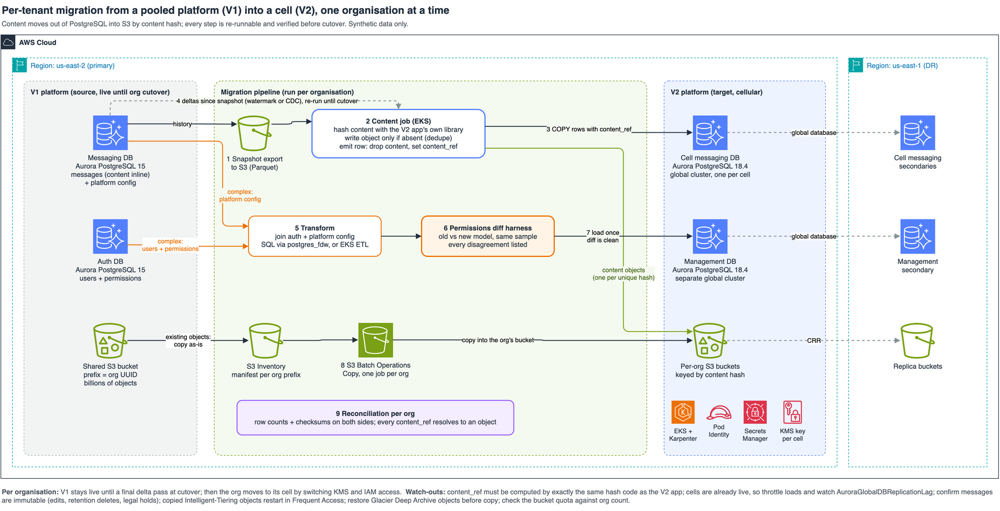

# Tenant migration into a cell

The diagram below shows how to move one tenant at a time from a pooled platform (V1) into a cell-based platform (V2). The target schema differs from the source: message content leaves PostgreSQL for Amazon S3, and each row keeps only a content-addressable reference. Every step can be re-run safely, and the migration ends with a verdict on whether the tenant is ready to cut over.

Tenant migration is a core capability of sharded and cellular SaaS architectures (see [Scale your relational database for SaaS, Part 2](https://aws.amazon.com/blogs/database/scale-your-relational-database-for-saas-part-2-sharding-and-routing/) and the [SaaS storage strategies whitepaper](https://docs.aws.amazon.com/whitepapers/latest/multi-tenant-saas-storage-strategies/data-migration.html)). This architecture implements the **Clone → Flip → Redirect → Forget** sequence from [Reducing the scope of impact with cell-based architecture: Cell migration](https://docs.aws.amazon.com/wellarchitected/latest/reducing-scope-of-impact-with-cell-based-architecture/cell-migration.html).

## Components

1. **V1 platform**: Amazon Aurora PostgreSQL databases (messaging with inline content and platform configuration, plus auth), and a shared S3 bucket with objects under a tenant ID prefix.
2. **Content job**: a container (Kubernetes Job on Amazon EKS with [EKS Pod Identity](https://docs.aws.amazon.com/eks/latest/userguide/pod-identities.html), or an Amazon ECS task on [AWS Fargate](https://docs.aws.amazon.com/AmazonECS/latest/developerguide/AWS_Fargate.html)) that hashes each message's content, writes it to the tenant's S3 bucket only if the key is absent, and loads the row with `content_ref` into the cell.
3. **Configuration transform**: SQL using [`postgres_fdw`](https://docs.aws.amazon.com/prescriptive-guidance/latest/aurora-postgresql-integration/remote-postgresql-databases.html) from the management database. It connects as a read-only role that can't see credentials, joins auth and platform configuration, expands wildcard permissions against the application catalogue, subtracts denies, converges changes and deletions, and replaces connector credentials with a reference to [AWS Secrets Manager](https://docs.aws.amazon.com/secretsmanager/latest/userguide/intro.html).
4. **Permissions diff harness**: evaluates the old and new authorization models independently, on every (user, resource, action) in the application catalogue, and lists every disagreement.
5. **[S3 Batch Operations](https://docs.aws.amazon.com/AmazonS3/latest/userguide/batch-ops-examples-copy.html)**: one Copy job per tenant, with a manifest built from [S3 Inventory](https://docs.aws.amazon.com/AmazonS3/latest/userguide/storage-inventory.html) filtered by the tenant prefix.
6. **Reconciliation**: compares row counts and checksums, checks that every `content_ref` resolves to an object, round-trips a sample of content, and confirms every shared object was copied.
7. **V2 cell**: a cell messaging database (Aurora PostgreSQL global cluster per cell), a management database, and per-tenant S3 buckets encrypted with a cell AWS KMS key.

## Steps

1. **Clone (bulk):** [export the tenant's tables from a snapshot](https://docs.aws.amazon.com/AmazonRDS/latest/AuroraUserGuide/aurora-export-snapshot.html), so V1 production carries no load.
2. **Clone (content):** for each row, compute `content_ref`, write the object if absent ([S3 conditional writes](https://docs.aws.amazon.com/AmazonS3/latest/userguide/conditional-writes.html) make identical content a single object, and make re-runs free), then `COPY` the row without its content.
3. **Clone (deltas):** re-run the same job from a per-tenant watermark until cutover. New V1 rows follow the same code path as the bulk pass. If rows can change or be deleted, capture changes with [AWS DMS](https://docs.aws.amazon.com/dms/latest/userguide/CHAP_Source.PostgreSQL.html) instead of a watermark. For tables whose schema doesn't change, [logical replication with row filters](https://aws.amazon.com/blogs/database/postgresql-logical-replication-how-to-replicate-only-the-data-that-you-need/) is an alternative.
4. **Clone (configuration and permissions):** transform into the management database.
5. **Verify:** run the permissions diff harness and the reconciliation. Any disagreement or failed check blocks cutover.
6. **Flip and Redirect:** refuse unless the tenant is still on V1, freeze its writes, wait out the router's placement-cache TTL (or block writes on the V1 side), run a final delta pass that also anti-joins for late commits, re-verify, update the tenant-to-cell mapping (`tenant_placement`), and grant the cell's IAM and KMS access. If re-verification fails or any step raises an exception, set the tenant back to V1. V1 was authoritative throughout, so nothing has to be undone.
7. **Forget:** remove the tenant from V1 after the retention window.

## Considerations

* Copied [S3 Intelligent-Tiering](https://docs.aws.amazon.com/AmazonS3/latest/userguide/intelligent-tiering-overview.html) objects restart in the Frequent Access tier. Budget for the temporary cost increase.
* [Restore](https://docs.aws.amazon.com/AmazonS3/latest/userguide/restoring-objects.html) S3 Glacier Deep Archive objects before copying them.
* A manually created S3 Batch Operations manifest [must not use SSE-KMS](https://docs.aws.amazon.com/AmazonS3/latest/userguide/batch-ops-create-job.html). Write it with SSE-S3. (CSV S3 Inventory reports can be SSE-KMS.)
* At small-object scale, per-request latency, not bandwidth, limits throughput. Run S3 writes concurrently.
* If the target cell is already serving other tenants, throttle loads and watch [`AuroraGlobalDBReplicationLag`](https://docs.aws.amazon.com/AmazonRDS/latest/AuroraUserGuide/Aurora.AuroraMonitoring.Metrics.html).

For a runnable implementation, see the [tenant migration to cells sample](../samples/tenant-migration-to-cells/) and its [complete guide](../samples/tenant-migration-to-cells/docs/GUIDE.md).
