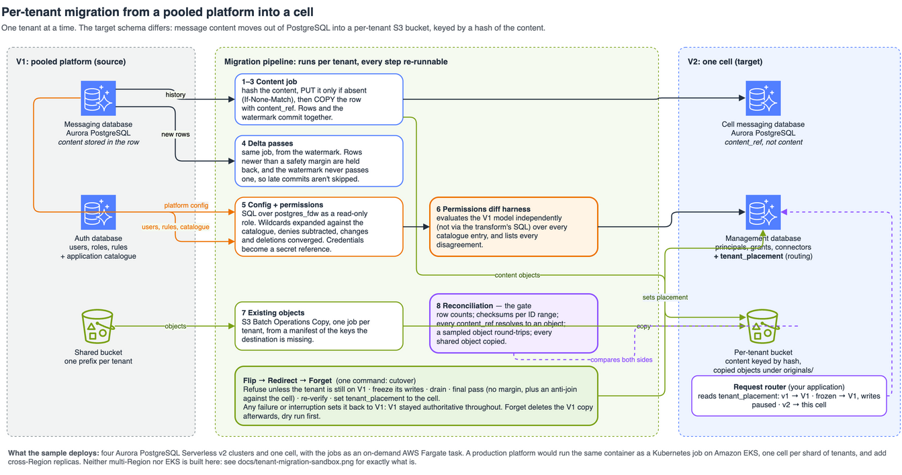
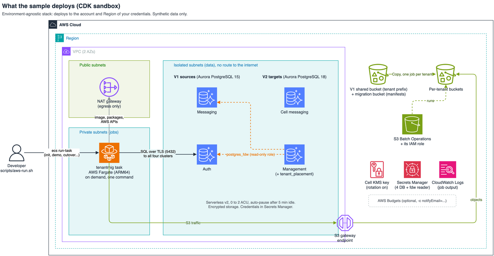
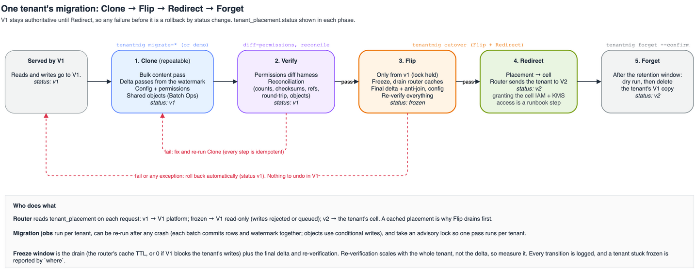
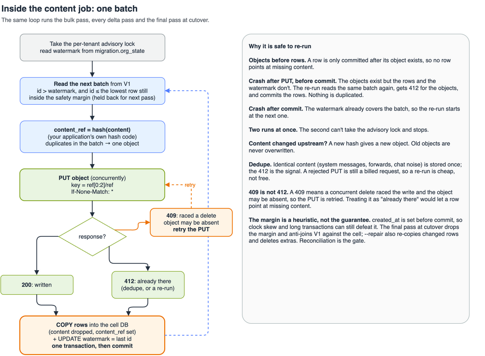

# Tenant migration into a cell: guide

How the sample works, how to run it, and what to watch for in production. For a quick start, see the [README](../README.md).

1. [When to use this](#when-to-use-this)
2. [Architecture](#architecture)
3. [The four phases](#the-four-phases)
4. [Run it](#run-it)
5. [How each step works](#how-each-step-works)
6. [Cutover runbook](#cutover-runbook)
7. [Scale and cost](#scale-and-cost)
8. [Security](#security)
9. [Adapting it](#adapting-it)
10. [Testing](#testing)
11. [Troubleshooting](#troubleshooting)
12. [Further reading](#further-reading)

## When to use this

Moving **existing tenants** between storage layouts, one at a time, where each move has to be proved correct before it goes live:

* into a [cell-based architecture](https://docs.aws.amazon.com/wellarchitected/latest/reducing-scope-of-impact-with-cell-based-architecture/reducing-scope-of-impact-with-cell-based-architecture.html);
* into a silo, or rebalanced across shards — [Scale your relational database for SaaS, Part 2](https://aws.amazon.com/blogs/database/scale-your-relational-database-for-saas-part-2-sharding-and-routing/) calls this "required as part of the core architecture";
* re-platforming where the **target schema differs**, as here: message content leaves PostgreSQL for a per-tenant S3 bucket, and each row keeps a content hash instead.

If the schema doesn't change, [logical replication with row filters](https://aws.amazon.com/blogs/database/postgresql-logical-replication-how-to-replicate-only-the-data-that-you-need/) or [AWS DMS](https://docs.aws.amazon.com/dms/latest/userguide/CHAP_Source.PostgreSQL.html) may be enough. The verification and cutover parts below still apply.

## Architecture



| | V1 (source) | V2 (target) |
|---|---|---|
| Messages | Messaging database, `content` inline | Cell messaging database (one Aurora global cluster per cell), `content_ref` only |
| Content | In the row | Per-tenant bucket, key = content hash |
| Config and permissions | Auth database, plus platform config in messaging | Management database |
| Existing objects | Shared bucket, prefix per tenant | Per-tenant bucket, `originals/` |
| Routing | Application assumes V1 | `tenant_placement` decides |

**What the sample deploys** is a cost-conscious slice of that: a VPC with isolated database subnets and one NAT gateway, four Aurora PostgreSQL Serverless v2 clusters that [pause at 0 ACU](https://docs.aws.amazon.com/AmazonRDS/latest/AuroraUserGuide/aurora-serverless-v2-auto-pause.html), a cell KMS key, a Batch Operations role, and the jobs as an on-demand [Fargate](https://docs.aws.amazon.com/AmazonECS/latest/developerguide/AWS_Fargate.html) task. In production the same container would usually be a Kubernetes Job on EKS with [Pod Identity](https://docs.aws.amazon.com/eks/latest/userguide/pod-identities.html); Fargate just avoids paying for a control plane.



## The four phases

[Cell migration](https://docs.aws.amazon.com/wellarchitected/latest/reducing-scope-of-impact-with-cell-based-architecture/cell-migration.html) in the Well-Architected guidance: Clone, Flip, Redirect, Forget. This sample adds an explicit verify step.



| Phase | What happens | Command | `status` |
|---|---|---|---|
| Clone | Content, deltas, config, objects. Repeatable | `migrate-content`, `migrate-config`, `migrate-objects` | `v1` |
| Verify | Permissions diff harness and reconciliation | `diff-permissions`, `reconcile` | `v1` |
| Flip | Freeze writes, drain, final pass, re-verify | `cutover` | `frozen` |
| Redirect | Route the tenant to its cell | `cutover` (on success) | `v2` |
| Forget | After the retention window, delete the V1 copy | `forget --confirm` | `v2` |

**V1 stays authoritative until Redirect.** Every failure before it is a status change back to `v1`, which `cutover` does automatically — nothing has to be undone in V1. Transitions are recorded in `tenant_placement_log`.

Terminology note if you read both: the guidance uses *Flip* for the moment the new copy becomes authoritative. Here that is *Redirect*, and Flip is the freeze plus final catch-up. Same order, different label.

## Run it

Locally, on PostgreSQL 15 + 18 and MinIO (`brew install postgresql@15 postgresql@18 minio`, or `docker compose up -d`), with Python 3.11+ and [uv](https://docs.astral.sh/uv/):

```bash
uv venv && uv pip install -e .
./scripts/local-up.sh && source .local/env
tenantmig demo                        # three synthetic tenants, first one migrated end to end
```

Then one step at a time:

```bash
ORG=$(tenantmig orgs | python3 -c "import json,sys; print(json.load(sys.stdin)[1])")
tenantmig migrate-content $ORG
tenantmig migrate-content $ORG        # re-run: 0 rows, 0 objects
tenantmig migrate-config $ORG --inject-bug
tenantmig diff-permissions $ORG       # lists users who would gain write access V1 denies
tenantmig migrate-config $ORG         # fixed: 0 disagreements
tenantmig migrate-objects $ORG
tenantmig reconcile $ORG
tenantmig cutover $ORG
tenantmig cutover $ORG                # refused: already on v2
tenantmig where $ORG                  # routing decision and history
tenantmig forget $ORG                 # dry run
tenantmig forget $ORG --confirm
./scripts/local-down.sh --wipe
```

On AWS:

```bash
cd infra && npm install && npx cdk bootstrap && npx cdk deploy
cd .. && ./scripts/aws-run.sh init                 # schemas, roles, policies and the fdw (admin)
./scripts/aws-run.sh demo --messages 2000
./scripts/aws-run.sh demo --inject-bug             # exits non-zero: NOT READY TO CUT OVER
./scripts/aws-run.sh purge-buckets                 # buckets are created at run time, so purge
cd infra && npx cdk destroy                        # before destroy
```

`aws-run.sh` runs one `tenantmig` command as a one-off Fargate task and prints its logs, using your current credentials in `us-east-2` by default. A test run there: 2,000-row bulk pass in 2–5 s with 32 concurrent PUTs, 600 permission decisions with 0 disagreements (13 with `--inject-bug`), 200 of 200 objects copied, reconciliation and cutover passed with a 10-row final delta.

## How each step works

### Content (steps 1–4)



Per batch of rows after the watermark: hash the content, `PUT` it with [`If-None-Match: *`](https://docs.aws.amazon.com/AmazonS3/latest/userguide/conditional-writes.html), `COPY` the rows into the cell with `content_ref` set. Four rules make it re-runnable:

* **Objects before rows**, so a committed row never points at missing content.
* **Rows and the watermark commit together**, so a crashed pass resumes from the last committed batch with no duplicates.
* **One pass per tenant**, via a PostgreSQL advisory lock.
* **412 means done; 409 means retry.** A 409 says a concurrent delete raced the write and the object may be absent, so treating it as "already there" could leave a row pointing at nothing.

**Late commits.** IDs are handed out before commit, so a lower ID can commit after a higher one, and a watermark alone would step over it for good. Delta passes ignore rows created within `DELTA_SAFETY_SECONDS` (60) **and hold the watermark below the lowest held-back row** — holding rows back isn't enough on its own. `held_back` reports how many. That margin is only a heuristic: `created_at` is set at write time, not commit time, so clock skew and long transactions defeat it. The guarantee is the final pass, which drops the margin, reads the V1 **writer**, and anti-joins V1 against the cell one ID range at a time. Reconciliation is the gate, not the margin.

PUTs run 32 at a time (`S3_WORKERS`); with small objects per-request latency is the limit, not bandwidth — the same 2,000-row pass took 74 s sequentially. In production read the bulk pass from an [Aurora snapshot export](https://docs.aws.amazon.com/AmazonRDS/latest/AuroraUserGuide/aurora-export-snapshot.html) and point deltas at a replica (`V1_MESSAGING_READ_DSN`); the final pass and `--repair` always read the writer.

### Config and permissions (step 5)

`INSERT … SELECT` from the management database over [`postgres_fdw`](https://docs.aws.amazon.com/prescriptive-guidance/latest/aurora-postgresql-integration/remote-postgresql-databases.html):

* **Credentials can't travel this path.** The foreign table doesn't declare the `credentials` column. The migrator reads V1 as the tenant's own login, which has no `SELECT` on that column either. Connectors get a Secrets Manager `secret_ref` instead.
* **Wildcards expand against the application catalogue** (`catalogue_resources`, `catalogue_actions`) — the product's real list of resources and actions — not against the rules. So a resource no rule names is still granted to a `*` role. In the synthetic data nothing names `connector` or `approve`, and admins still get both. Denies are subtracted.
* **Every run converges V2 on V1**: changed rows updated, rows deleted in V1 deleted in V2, grants rebuilt. A config change made before the freeze is picked up by the final config pass.

### Permissions diff harness (step 6)

For every (user, resource, action) in the catalogue, the harness evaluates the **V1 model in its own code** and compares with the V2 grants, listing both decisions for each disagreement. It deliberately doesn't reuse the transform's SQL, so a bug there can't hide itself, and neither side derives the catalogue — otherwise both would build the same wrong list of resources and agree. It also reports V1 rules naming anything outside the catalogue, which the transform drops silently. `--inject-bug` reintroduces a real mistake (ignoring wildcard denies) to show it caught.

### Objects (step 7)

[S3 Batch Operations](https://docs.aws.amazon.com/AmazonS3/latest/userguide/batch-ops-examples-copy.html) Copy, one job per tenant, from a CSV manifest in a separate migration bucket; failed-task reports land beside it. Only keys the destination lacks, or holds a different copy of (size or ETag differ), go in the manifest, so a re-run (and the cutover re-check) costs one LIST. A source object overwritten after its first copy is copied again. The step fails — and so rolls cutover back — if the job doesn't complete within `BATCH_TIMEOUT_SECONDS` or any task fails. MinIO has no Batch Operations, so local runs copy directly.

### Reconciliation (step 8) — the gate

Passes only if all five hold:

| Check | Why |
|---|---|
| Row counts match | Nothing lost or duplicated |
| Checksums match per ID range — an ordered hash over (id, channel, sender, sent_at, content hash) per 50,000 IDs, V1's content hash computed **in SQL** | Values and content are identical, and the job's hashing agrees with the database's. Per-range keeps each aggregate well under PostgreSQL's 1 GB text limit at any tenant size, and `mismatched_id_ranges` says where to look |
| Every distinct `content_ref` resolves to an object | Counts and checksums can pass while objects are missing. In testing this is the check that caught real failures |
| A sampled object round-trips against V1 content | End-to-end content check |
| Every shared object was copied, and the copy has the same bytes | Step 7 finished. Single-part objects are compared by ETag (their MD5). Multipart objects are compared by a full-object SHA-256, because a copy of a multipart object gets a different ETag even when the bytes match (verified on S3). That's a read of each multipart source, so for a large archive run a Batch Operations [compute checksum](https://docs.aws.amazon.com/AmazonS3/latest/userguide/batch-ops-compute-checksums.html) job on both sides instead |

### Cutover, and repair

`cutover` runs only on a `v1` tenant (or a `frozen` one left by a crash). It freezes writes, drains, runs the final content and config passes, re-copies missing objects, re-verifies, then redirects. Any failure, exception or interruption (`SIGTERM`, `Ctrl-C`) rolls it back to `v1`.

A `SIGKILL` or a dead host can leave a tenant `frozen`. Re-running is safe. In production, alarm on `frozen_for_seconds` from `where`.

**The drain is weaker than it looks.** It limits when the router *decides* where a write goes, not when the write *commits*:

| Writer | Stopped by the drain? |
|---|---|
| A request the router already sent to V1 | No: a slow request or a retry commits later |
| Connectors, queue consumers, batch jobs | No: they never read `tenant_placement` |
| A new request, after every router cache refreshed | Yes |

For anything but a router-only write path, block writes in V1 and pass `--drain-seconds 0`. The strongest way is a trigger or row-level policy on the V1 tables that rejects writes unless the tenant is `v1`. Then wait for open transactions to finish.

`--repair` backfills missing rows, re-copies rows that differ, and deletes cell rows whose V1 row is gone. `forget` is a dry run unless `--confirm`, deletes in chunks of 10,000, and needs the tenant to be `v2`.

The router reads `tenant_placement`: `v1` serves from V1, `frozen` rejects writes, and `v2` serves from the cell. A DynamoDB mapping table, as in the [sharding reference architecture](../../../reference-architectures/relational-database-sharding.md), works equally well.

## Cutover runbook

Per tenant. Large tenants need several Clone cycles first.

1. Clone until deltas are small.
2. Verify: 0 disagreements and reconciliation passing. Fix and repeat until both are clean.
3. Confirm cell monitoring: error rate, latency, [`AuroraGlobalDBReplicationLag`](https://docs.aws.amazon.com/AmazonRDS/latest/AuroraUserGuide/Aurora.AuroraMonitoring.Metrics.html).
4. **Switch the cell's IAM and KMS access for the tenant bucket on, before the cutover.** The serving identity has to be able to read the tenant's data before the router can send it traffic. Granting access to a tenant the router still sends to V1 is harmless.
5. **Size the freeze from the tenant, not the delta.** The delta is small, but re-verification re-hashes every V1 content row, lists the bucket and walks every ID range, so it scales with the whole dataset. The object step is incremental; the checksum pass is not. Measure it on a copy of the tenant before agreeing a window, and for a very large tenant verify unchanged ranges before the freeze.
6. Run `cutover --drain-seconds N` — your router's cache TTL plus a margin, or 0 if writes are blocked in V1.
7. Remove V1's write access to the tenant's data.
8. Smoke-test as the tenant: recent messages, and permissions for a known admin and a known read-only user.
9. Watch the cell. Rolling back after Redirect means setting `v1` again — V1 still holds the data, but writes made in V2 would need replaying, so agree that window in advance.
10. After the retention window: `forget`, review the output, then `forget --confirm`.

## Scale and cost

**Throughput.** S3 allows at least [3,500 PUT/s per partitioned prefix](https://repost.aws/knowledge-center/s3-object-key-naming-pattern), and hash-prefixed keys (`ab/abcd…`) spread writes across them. Run tenants in parallel — each has its own bucket, watermark and lock — split very large ones across [concurrent Batch Operations jobs](https://aws.amazon.com/s3/features/batch-operations/), size the cell's writer for the load window, and throttle if the cell already serves traffic.

**Cost drivers** ([S3](https://aws.amazon.com/s3/pricing/), [Aurora](https://aws.amazon.com/rds/aurora/pricing/)):

* **Requests** — roughly one PUT per unique content object plus one per shared object. Deduplication cuts the first.
* **Storage class on the copy.** A copy lands in the destination's **default** class unless the job sets one, so here it lands in S3 Standard. Setting [Intelligent-Tiering](https://docs.aws.amazon.com/AmazonS3/latest/userguide/intelligent-tiering-overview.html) instead restarts monitoring at Frequent Access (30 and 90 days to tier down), and objects under 128 KB never auto-tier — so a mostly-cold archive is billed at Frequent Access rates for a quarter. For a large archive this is often the biggest one-off cost; decide it deliberately.
* **Archive restores.** [Restore](https://docs.aws.amazon.com/AmazonS3/latest/userguide/restoring-objects.html) Glacier Flexible Retrieval, Deep Archive and Intelligent-Tiering archive-tier objects before copying.
* **Batch Operations** per job and per object; **Aurora** capacity during the window, plus cross-Region replication for global clusters.

**Sandbox:** idle, the NAT gateway dominates ([VPC pricing](https://aws.amazon.com/vpc/pricing/)) and Aurora pauses at 0 ACU. Destroy the stack when you're done.

## Security

| Control | What it does |
|---|---|
| Tenant isolation | Each tenant has its own logins, and row-level security keeps each one to its tenant. The policies read the tenant from the login name, so a session can't pick another tenant. The owner is exempt, so setup and tests use it. |
| Identities | Per tenant: a **tenant** login (its rows), a **migrator** login (its configuration) and a **control** login (its routing row). Setup runs as the owner, and the job task never gets the owner's password. |
| Task roles (AWS) | Each tenant's job runs under its own task role. It can read only that tenant's secret and touch only that tenant's buckets. Batch Operations and KMS are shared, because `CreateJob` can't be scoped to one tenant. |
| Passwords | Secrets Manager on AWS, and one secret per tenant. A step fails if its password is missing. The migrator's fdw mapping stores the tenant's login password in clear text in the management database, as `postgres_fdw` does. Only the owner can read it. |
| Credentials | The `credentials` column is never copied, and no tenant role can read it. Connectors carry a Secrets Manager reference instead. |
| Bulk loads | Batched `INSERT`, not `COPY`: PostgreSQL refuses `COPY` into an RLS table for any role that isn't the owner. |
| Bucket names | Guessable and globally unique, so calls on existing buckets send `ExpectedBucketOwner`. `CreateBucket` doesn't accept it, so creation relies on the task role's name-prefix scope. |
| TLS | Use `verify-full` with the [RDS CA bundle](https://docs.aws.amazon.com/AmazonRDS/latest/AuroraUserGuide/UsingWithRDS.SSL.html) for the job's own connections in production. The fdw hop can't be verified on Aurora: its client is the managed instance, and `verify-full` fails with `CERTIFICATE_VERIFY_FAILED` even with `sslrootcert=system`. That hop is confined to isolated subnets, and only the management group can reach the V1 clusters. |
| Guards | `generate`, `init`, `reset`, `purge-buckets` and `demo` need `TENANTMIG_SANDBOX=1`. Every migration step refuses once a tenant is `v2`. |
| Network | Isolated database subnets with no route out, Block Public Access on buckets, no inbound rules on the task. One security group per cluster role; no group allows itself. |
| Replica | The final pass, `--repair` and reconciliation read the writer, not `V1_MESSAGING_READ_DSN`. Replica lag at cutover would make a missing row look like a matching count. |
| In production | Deletion protection, longer backup retention, and tenant passwords rotated (provisioning again applies the new one). |

## Adapting it

This sample targets one fixed pair of schemas. Each job names its tables and columns as literals, so
adapting it means rewriting those SQL bindings. The permission model is the largest change: three files
must change together (`config_job.GRANTS_SQL`, `perm_diff._old_decision` and `sql/v1/auth.sql`). Keep the
two evaluators separate, or the harness can't catch a transform bug.

What carries over unchanged: conditional-write deduplication, objects before rows, the watermark and
anti-join deltas, the advisory locks, the per-tenant identities, and the Clone → Flip → Redirect → Forget flow.

| Change | Where |
|---|---|
| The hash and key layout. **Call your application's own hashing code** or references won't resolve | `tenantmig/hashing.py` |
| Source and target schemas | `sql/`, plus the column lists in `content_job.py` and `reconcile.py` |
| The permission model, its old-model evaluator, and the catalogue populated from your product's real resources and actions | `config_job.py`, `perm_diff.py`, `catalogue_*` in `sql/v1/auth.sql` |
| `DELTA_SAFETY_SECONDS` (your longest write transaction) and `PLACEMENT_CACHE_TTL_SECONDS` (your router's cache TTL). If rows change or are deleted routinely, use change data capture instead of an `id` watermark | `settings.py`, `content_job.py` |
| **An ID strategy for the cell.** V1's `messages.id`, `principals.id` and `connectors.id` are carried across unchanged, which is the simplest thing verifiable row by row — but only works while V1 is the sole source. Before V2 issues its own, give each cell a non-overlapping range or switch to a UUID or (tenant, id) key, or a row written after cutover can collide with a V1 row from a tenant migrated later | `sql/v2/`, `content_job.py`, `config_job.py` |
| **Connector secrets.** `migrate-config` writes a `secret_ref` but doesn't create the secret. Set `CHECK_CONNECTOR_SECRETS=1` so cutover refuses while one doesn't resolve — after `forget` the V1 `credentials` column is gone for good | `cutover.py`, `config_job.py` |
| The bulk source: read the snapshot export (Parquet) instead of the live database | `content_job.py` |
| Manifests from [S3 Inventory](https://docs.aws.amazon.com/AmazonS3/latest/userguide/storage-inventory.html) filtered by tenant prefix, rather than listing | `object_job.py` |
| The router and placement store | `cutover.py`, `placement.py` |
| Roles, grants and policies: one tenant's logins, the group roles, and the row-level policies | `identities.py`, `sql/rls/` |
| Per-tenant task roles on AWS: which buckets and secret a tenant's job can touch | `task_roles.py` |

**Moving a tenant between cells** is smaller than moving it off V1, but not free: its rows have to be copied to the new cell's database, and its bucket is encrypted with the old cell's KMS key, so either grant the new cell that key or re-encrypt by copying. Only the routing change is instant.

## Testing

```bash
python -m pytest tests                                         # 7 unit tests, no database
./scripts/local-up.sh && source .local/env
TENANTMIG_INTEGRATION=1 python -m pytest tests                 # 24 integration tests
```

The integration tests cover the failure modes this pattern actually has: a crash mid-pass and a clean re-run, re-runs as no-ops, a lower ID committing late, repair converging deleted and edited rows, a 409 retried and a 412 treated as present, the injected permissions bug and an uncatalogued rule being caught, credentials unreadable through the fdw and a rotated password taking effect, concurrent `migrate-config` runs, an incremental object pass, cutover and forget, automatic rollback on a missing object and on an exception, and every sandbox and live-tenant guard.

## Troubleshooting

| Symptom | Cause and fix |
|---|---|
| Task can't reach Secrets Manager or CloudWatch Logs | No egress. The NAT gateway here also works under [VPC Block Public Access](https://docs.aws.amazon.com/vpc/latest/userguide/security-vpc-bpa.html) in `block-ingress` mode, where public IPs get no internet access |
| `Unsupported encryption type SSE_KMS used for manifest` | A [manually created manifest can't be SSE-KMS](https://docs.aws.amazon.com/AmazonS3/latest/userguide/batch-ops-create-job.html); the job writes it with SSE-S3 |
| Batch Operations tasks fail on `x-amz-server-side-encryption` | A KMS key was set on the Copy operation. Leave it out and copies inherit the bucket's default encryption |
| `iam:PassRole` denied on `s3:CreateJob` | Observed in testing: a `PassRole` statement conditioned on `iam:PassedToService = batchoperations.s3.amazonaws.com` denied the call, so that condition appears not to be set for `s3:CreateJob`. The documentation doesn't state this either way. Scope `PassRole` to the role ARN instead, as this sample does |
| First command times out connecting | Aurora resuming from auto-pause, usually ~15 s; the CLI retries for several minutes. Global-database clusters never auto-pause, so this is a sandbox-only behaviour |
| `another content pass is already running` | Two passes for one tenant. Wait for the first |
| `Refusing to cut over …: it is already v2` | The tenant is live in its cell. Deliberate |
| `mismatched_id_ranges` | Rows there are missing, changed or extra. `migrate-content <org> --repair` converges all three, then reconcile again |
| `Refusing to reset …: set TENANTMIG_SANDBOX=1` | A destructive command outside a sandbox |
| `Batch Operations copy failed` | Failed tasks are listed in the migration bucket under `_reports/<org>/`. Fix and re-run `migrate-objects` |
| Fails only on `all_shared_objects_copied` | Step 7 hasn't run for this tenant |
| `migrate-config` fails connecting, under Docker | `source scripts/docker.env`: the fdw reaches V1 by service name, not localhost |

## Further reading

* [Reducing the scope of impact with cell-based architecture](https://docs.aws.amazon.com/wellarchitected/latest/reducing-scope-of-impact-with-cell-based-architecture/reducing-scope-of-impact-with-cell-based-architecture.html), including [cell migration](https://docs.aws.amazon.com/wellarchitected/latest/reducing-scope-of-impact-with-cell-based-architecture/cell-migration.html)
* [Scale your relational database for SaaS, Part 2: Sharding and routing](https://aws.amazon.com/blogs/database/scale-your-relational-database-for-saas-part-2-sharding-and-routing/)
* [SaaS storage strategies: data migration](https://docs.aws.amazon.com/whitepapers/latest/multi-tenant-saas-storage-strategies/data-migration.html)
* [Building multi-writer applications on Amazon S3 using native controls](https://aws.amazon.com/blogs/storage/building-multi-writer-applications-on-amazon-s3-using-native-controls/)
* [PostgreSQL logical replication: replicate only the data that you need](https://aws.amazon.com/blogs/database/postgresql-logical-replication-how-to-replicate-only-the-data-that-you-need/)
* [Copy objects between S3 storage classes using S3 Batch Operations](https://aws.amazon.com/blogs/storage/copy-objects-between-any-amazon-s3-storage-classes-using-s3-batch-operations/)
